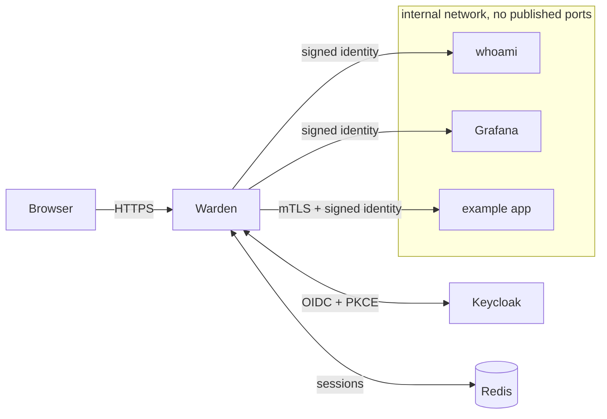

# Warden

**A zero-trust, identity-aware reverse proxy in Go.** Warden is the only door to your internal
apps: every request is authenticated with OpenID Connect, checked against a per-path policy,
audited, and forwarded with a signed identity the app can verify. Nothing behind it is trusted
just for being on the network.

**[Try the admin dashboard →](https://warden-proxy.vercel.app/)** (static showcase with sample
data: revoke sessions, browse an audit log full of blocked attacks)

---

## How it works



For each request Warden:

1. **Normalizes the path** once, rejecting ambiguous encodings (`%2F`, `\`, NUL, `..` tricks)
   instead of guessing, so the policy and the app always see the same path.
2. **Authenticates** the browser with a server-side, revocable session, or sends it through an
   OIDC login (authorization code + PKCE, `state` and `nonce` bound to the browser).
3. **Evaluates the route's policy**: users, groups, email domains, and "MFA within N minutes",
   longest path prefix wins, default deny.
4. **Strips** every identity header the client sent, then **injects** a short-lived signed
   assertion (ES256 JWT, audience = that app) the app verifies against Warden's JWKS.
5. **Audits** the decision (who, what, allow or deny, which rule, why) and proxies the request.

## Security features

| Area | What Warden does |
|---|---|
| **Login** | Authorization code + PKCE (S256); single-use `state`/`nonce` sealed in a per-login cookie; full ID token validation (pinned algorithms, `iss`, `aud`, `exp`, `iat`, `nonce`, `azp`); no `alg: none`, no HMAC confusion |
| **Sessions** | 256-bit opaque IDs, only hashes stored; idle and absolute timeouts; host-only `HttpOnly`/`Secure`/`SameSite` cookies (`__Host-` for login state); cross-domain SSO via one-time, browser-bound handshake codes |
| **Policy** | Pure, fuzzed evaluator; default deny; any error is a deny; per-path rules |
| **Step-up MFA** | A stale or single-factor login on an MFA path goes back to the IdP (`prompt=login`, `max_age=0`), and the new token must prove a fresh login; loop-proof |
| **Revocation** | Revoke a session or a user from the dashboard, effective on the next request; groups re-confirmed with the IdP on a schedule, and a failed refresh revokes |
| **Upstream trust** | Signed identity assertion per request; mTLS to upstreams with a name-constrained internal CA; apps on an internal network with no published ports |
| **Request hygiene** | Spoofed `X-Forwarded-*` overwritten, hop-by-hop headers stripped, Host/SNI mismatch refused, no open redirects, timeouts everywhere |
| **WebSockets** | Same checks as any request; only `Upgrade: websocket` (blocks h2c smuggling); same-origin only; open sockets re-checked and closed on revocation |
| **Abuse** | Token-bucket rate limits on login and the admin API, keyed on the real client IP |
| **Headers** | HSTS, strict CSP with no inline code, `frame-ancestors 'none'`, `nosniff`, `no-referrer` on everything Warden serves |
| **Audit** | One event per request (JSONL), fail-closed decision encoding, no secrets, tested with planted tokens |
| **Admin** | Dashboard and API behind their own MFA policy, with CSRF tokens and same-origin checks |

Every mitigation is mapped to a threat in **[docs/THREAT_MODEL.md](docs/THREAT_MODEL.md)**, and
every non-obvious choice is explained in **[docs/DECISIONS.md](docs/DECISIONS.md)**.

## Tech stack

- **Go**, standard library first: `net/http/httputil.ReverseProxy`, `log/slog`, `crypto/*`
- [`coreos/go-oidc`](https://github.com/coreos/go-oidc) + `golang.org/x/oauth2` for OIDC,
  [`go-jose`](https://github.com/go-jose/go-jose) for signing, [`go-redis`](https://github.com/redis/go-redis) for sessions
- **React + TypeScript + Vite** admin dashboard, embedded in the binary with `go:embed`
- **Docker Compose** dev stack: Keycloak (with TOTP), Redis, Grafana, whoami, and an example app
  that verifies Warden's assertion
- Distroless, non-root, read-only containers with pinned image digests

## Run it locally

You need Docker, Go 1.26+, and [mkcert](https://github.com/FiloSottile/mkcert). (Node 24 only
if you build the dashboard outside Docker: `make build`, `make showcase`.)

```sh
cp .env.example .env
mkcert -install       # trust the local dev CA (once)
make certs            # TLS certs, identity signing key, internal CA for mTLS
make dev-up           # Warden, Keycloak, Redis, and the apps, in containers
make dev-check        # verify the apps are unreachable except through Warden
```

Then open <https://whoami.warden.localhost:8443/> (browsers resolve `*.localhost` to your
machine). Test users:

| User | Password | Groups | OTP |
|---|---|---|---|
| `alice` | `alice` | admins, sre | yes: key `K5QXEZDFNZCGK5SPORYEC3DJMNSTAMBR` in any authenticator app |
| `bob` | `bob` | dev | no |

Things to try: bob gets a 403 on <https://grafana.warden.localhost:8443/>; alice reaches
`/admin` there with her OTP code, and is asked for a fresh one once her login is over 10 minutes
old (step-up); the dashboard is at
<https://auth.warden.localhost:8443/.warden/admin/> (alice, with OTP), where revoking bob logs
him out on his next click.

**Demo mode** (`demo:` in the config) turns the auth host's root into a public landing page with
the demo accounts and their live OTP codes, scopes the dashboard to each visitor, and resets
everything hourly (D30).

## Tests

```sh
make test    # go test -race ./...
make lint    # go vet, golangci-lint, govulncheck
make fuzz    # path normalization, policy evaluation, return-URL validation
```

Security behavior is tested from the attacker's side: forged identity headers, path-encoding
tricks, open-redirect payloads, replayed and cross-browser login state, `alg: none` and
algorithm-confusion tokens, h2c smuggling, cross-site WebSockets, revocation reaching open
sockets, CSRF on the admin API. OIDC is tested end to end against a fake IdP, through the real
binary and its real listeners.

## Project layout

```
cmd/warden/          main binary
internal/proxy/      routing, reverse proxy, header hygiene, WebSockets
internal/authn/      OIDC login, callback, logout, cross-domain handshake, step-up
internal/session/    Redis session store and indexes
internal/policy/     policy evaluator (pure, fuzzed)
internal/pathnorm/   path normalization (pure, fuzzed)
internal/identity/   signed identity assertions and JWKS
internal/audit/      audit events and sinks
internal/admin/      admin API and dashboard serving
internal/ratelimit/  token-bucket rate limiting
internal/demo/       public demo mode
web/admin/           React dashboard (and its static showcase build)
examples/upstream/   a small app that verifies Warden's assertion
deploy/              Docker Compose stack and Keycloak realm
docs/                threat model, decision log, showcase deploy guide
```

## Status

A portfolio project, built as security-critical software: correctness and clear reasoning over
feature count. Not audited; don't put it in front of anything that matters without your own
review.
