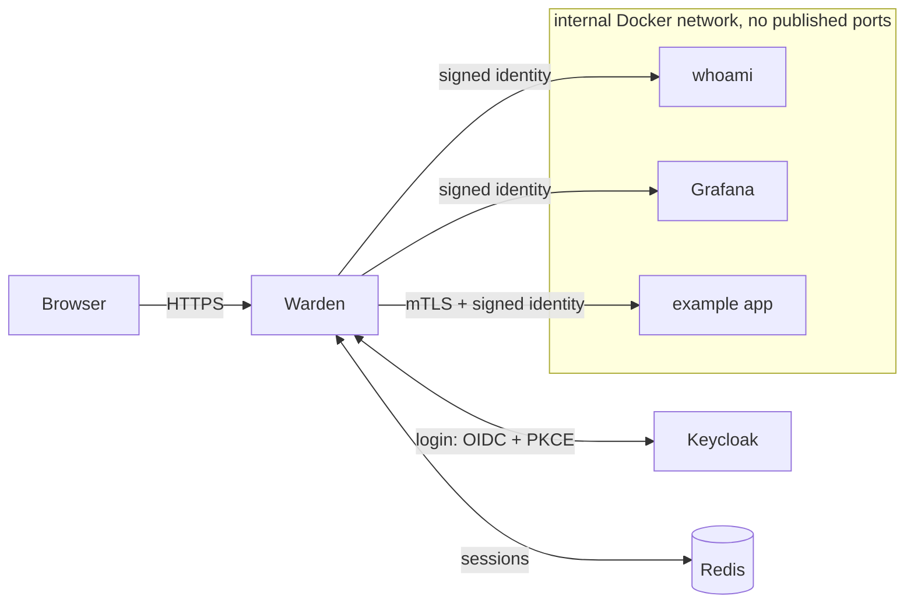

# Warden

Warden is a zero-trust reverse proxy I built in Go. It sits in front of internal apps (Grafana,
a test app, and so on) and checks every single request before letting it through: who you are,
whether you're allowed on that exact page, and it writes the decision to an audit log. The apps
behind it never trust anything just because it came from inside the network.

**Live demo of the admin dashboard: [warden-proxy.vercel.app](https://warden-proxy.vercel.app/)**
(it runs on sample data, so you can click around and revoke sessions without breaking anything)

## Why I built this

I wanted to understand how tools like Google's BeyondCorp / Identity-Aware Proxy, Cloudflare
Access, and oauth2-proxy actually work, instead of just knowing the buzzword "zero trust". The
idea is simple: stop trusting the network, and make one component check identity and
permissions on every request. Building it myself meant dealing with all the details that make
it hard, like OIDC login flows, sessions, and the many ways a request can try to sneak past a
proxy.

I treated it like real security software: I wrote a threat model first and kept a log of every
design decision, and for most features I wrote tests for the attack before writing the code.

## What happens on each request



1. **Clean up the path.** Warden normalizes the URL path once and rejects weird encodings
   (`%2F`, backslashes, `..` tricks) instead of guessing, so the policy and the app see the same
   path.
2. **Check who you are.** If you don't have a session, you get sent to Keycloak to log in
   (authorization code flow with PKCE). Sessions live in Redis, so they can be revoked.
3. **Check the policy.** Each app has rules like "only the `admins` group, and only if they used
   MFA in the last 10 minutes" for `/admin`. If no rule allows the request, it's denied.
4. **Pass on the identity safely.** Warden deletes any identity headers the client tried to
   send, then adds its own signed token (a JWT) that the app can verify.
5. **Log it.** Every allow and deny goes to an audit log with the user, path, rule, and reason.

## Features

- OIDC login with PKCE, full ID token validation, and protection against login CSRF
- Server-side sessions with idle and absolute timeouts, and single sign-on across apps
- Per-path policies (users, groups, email domains, "MFA within N minutes"), default deny
- **Step-up MFA:** if your login is too old for a protected page, you're sent back to enter
  your OTP code again, then land where you were going
- Signed identity assertions for apps, plus mTLS to upstreams
- Admin dashboard (React + TypeScript) to see sessions and revoke them, with an audit log viewer
- Revocation that takes effect on the next request, including open WebSockets
- Rate limiting on login and the admin API
- Security headers (HSTS, strict CSP, no framing) on every page Warden serves
- A demo mode for running it publicly, with demo accounts, live OTP codes, and hourly resets
- Runs in Docker with the apps on an internal network, so the only way in is through Warden

## Some problems I ran into

**The same URL means different things in Docker.** Warden checks that login tokens come from
an exact issuer URL. But `localhost:8180` means my laptop to the browser and the Warden
container itself inside Docker, so the issuer never matched. I fixed it by giving Keycloak the
name `keycloak.localhost`, which browsers send to my machine and Docker sends to the Keycloak
container, so both see the same URL.

**Blocking path tricks.** A request for `/%2e%2e/admin` or `/admin%2Fusers` can be read
differently by the proxy and the app, which can be used to sneak past a rule. Instead of trying
to decode these "correctly", Warden rejects ambiguous paths outright. This part is fuzz tested.

**h2c smuggling.** Go's reverse proxy forwards any `Upgrade` request. If an app supports h2c,
a client can turn its connection into raw HTTP/2 and then request any path directly, skipping
the per-path rules. Warden now only allows `Upgrade: websocket`.

**Revoking a WebSocket.** Revocation normally applies "on the next request", but a WebSocket is
one long request. Warden re-checks open sockets every 30 seconds and closes them if the session
or the policy says no.

**Step-up without infinite loops.** If a user has no second factor, sending them back to log in
again just loops forever. Warden only offers a step-up when re-logging in could actually help,
and it checks that the identity provider really made the user log in again.

## Tech stack

- **Go** (mostly the standard library), `go-oidc`, `oauth2`, `go-jose`, `go-redis`
- **Keycloak** as the identity provider, with TOTP for MFA
- **Redis** for sessions
- **React + TypeScript + Vite** for the dashboard, built into the Go binary with `go:embed`
- **Docker Compose** for the whole dev environment, with distroless non-root containers

## Running it

You need Docker, Go 1.26+, and [mkcert](https://github.com/FiloSottile/mkcert).

```sh
cp .env.example .env
mkcert -install     # trust the local dev certificate authority (once)
make certs          # make the TLS certs and signing keys
make dev-up         # start Warden, Keycloak, Redis, and the apps
make dev-check      # check that the apps can only be reached through Warden
```

Then open <https://whoami.warden.localhost:8443/>. Test users:

| User | Password | Groups | OTP |
|---|---|---|---|
| `alice` | `alice` | admins, sre | yes, key `K5QXEZDFNZCGK5SPORYEC3DJMNSTAMBR` (add it to any authenticator app) |
| `bob` | `bob` | dev | no |

Things to try:
- Log in as bob and open <https://grafana.warden.localhost:8443/>: you get a 403
- Log in as alice and open Grafana's `/admin`: you need your OTP code, and once your login is
  more than 10 minutes old you're asked for it again
- As alice, open the dashboard at <https://auth.warden.localhost:8443/.warden/admin/>, log in
  as bob in a private window, then revoke bob: his next click sends him back to the login page

## Testing

```sh
make test    # all tests, with the race detector
make lint    # go vet, golangci-lint, govulncheck
make fuzz    # fuzz the path normalizer, the policy engine, and return-URL checks
```

A lot of the tests are attack tests: forged identity headers, path tricks, open redirects,
replayed login state, `alg: none` tokens, h2c smuggling, cross-site WebSockets, and CSRF on the
admin API. The login flow is tested end to end against a fake identity provider.

## Docs

- [Threat model](docs/THREAT_MODEL.md): what I'm defending against and how
- [Decision log](docs/DECISIONS.md): why I made each design choice
- [Showcase deploy](docs/SHOWCASE.md): how the dashboard demo is hosted on Vercel

## What I learned

- How OIDC really works under the hood (PKCE, state, nonce, what to check in an ID token), and
  how many small checks a login flow needs to be safe
- That "zero trust" is mostly careful plumbing: header stripping, path normalization,
  timeouts, and default deny everywhere
- Writing a threat model before coding changes what you build
- Writing the attack test first is a good way to make sure a fix actually works

## Status

This is a learning and portfolio project. I built it carefully, but it hasn't been audited, so
please don't put it in front of anything important.
